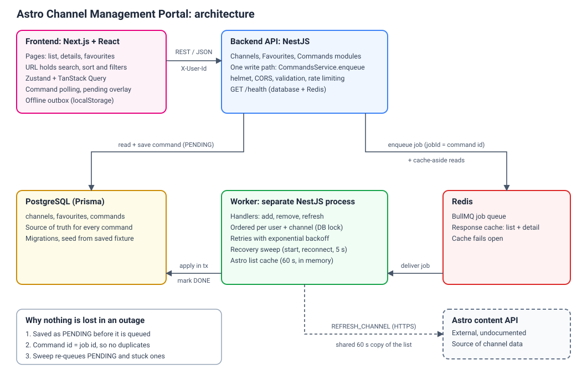
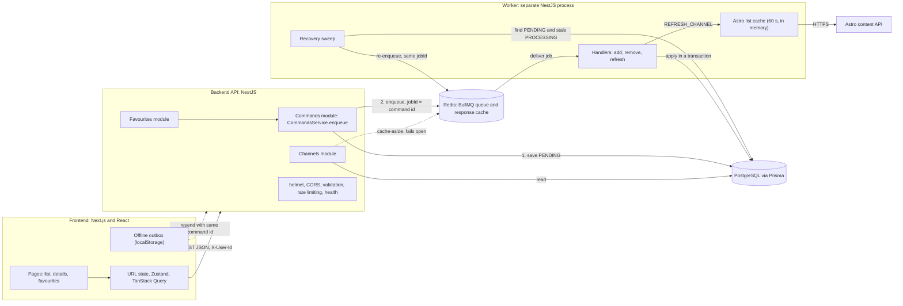
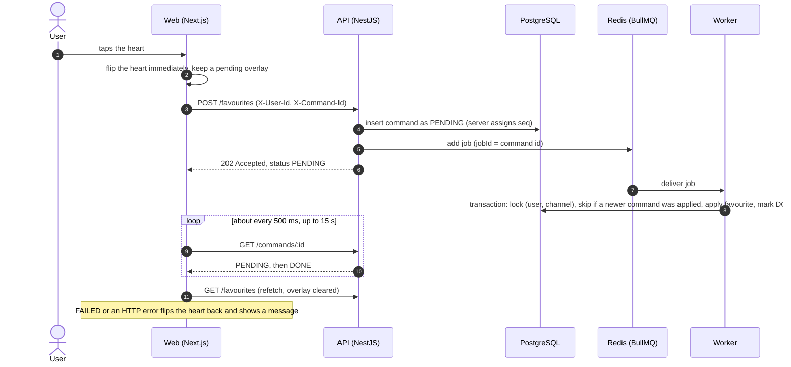
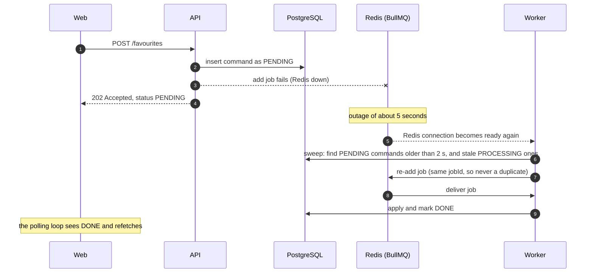

# Architecture

The diagram above shows the five parts the brief asks for: **Frontend**, **Backend**, **Database**, **Queue layer** and the **Astro API**. The sections below cover how a command moves through the system and what happens when parts of it go down. The diagrams use Mermaid, which GitHub renders directly.

## Components

| Part | Technology | Responsibility |
|---|---|---|
| Frontend | Next.js, React, TypeScript, Zustand, TanStack Query | Channel list (search, sort, filters, infinite scroll), details page, favourites. The URL is the only place search, sort and filter state lives. |
| Backend API | NestJS | REST endpoints for channels, favourites and commands. Validation, CORS, helmet, rate limiting on write routes, `/health`. Never calls Astro. |
| Database | PostgreSQL, Prisma | `channels`, `favourites`, `commands`. The database is the source of truth: a command is saved here before anything else happens to it. |
| Queue layer | BullMQ on Redis, plus a separate NestJS worker process | Applies commands asynchronously with retries, ordering and a recovery sweep. Redis also holds the response cache. |
| Astro API | External, undocumented | Source of channel data. Reached only through an adapter (`AstroClient`) by the sync script and by the worker for `REFRESH_CHANNEL`. |

## System overview

## A favourite command, end to end

Why it is built this way:

- **One write path.** `POST /favourites`, `DELETE /favourites/:channelId` and `POST /commands` all call the same `CommandsService.enqueue`.
- **Database first.** The command is saved as PENDING before it is queued, so a queue problem can never lose it.
- **Idempotent.** The client-generated command id is the idempotency key and the queue job id, so a resend or a re-enqueue cannot create a second command or a second job.
- **Ordering.** Add and remove for the same user and channel are applied in `seq` order. Each job takes a Postgres advisory lock for that pair, skips itself if a newer command was already applied, and otherwise applies and marks DONE inside one transaction.
- **Refresh is different.** `REFRESH_CHANNEL` does not need ordering. Concurrent refreshes share one Astro request through the worker's short-lived in-memory copy of the list, and an older snapshot never overwrites a newer one.

## Surviving a 5-second outage

The recovery sweep runs when the API or worker starts, when the worker's Redis connection becomes ready again, and every 5 seconds as a backstop. It also recovers commands left in `PROCESSING` for longer than a stale threshold (for example a worker that died mid-job). Before re-adding a stuck command it removes any leftover finished job with the same id, because BullMQ ignores an add whose job id already exists.

The acceptance test (`npm run test:outage`) stops Redis for 5 seconds in the middle of a batch of commands from two users, then repeats the test with the worker stopped. In both cases every command must end DONE, with no duplicate favourites and a final state equal to each user's last command.

## Caching

`GET /channels` and `GET /channels/:id` use Redis cache-aside with short TTLs. The cache fails open, so if Redis is slow or down the request is served from PostgreSQL. A channel's detail cache entry is deleted when a refresh changes it; list caches simply expire.
